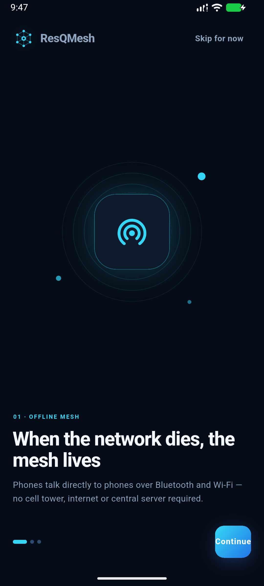
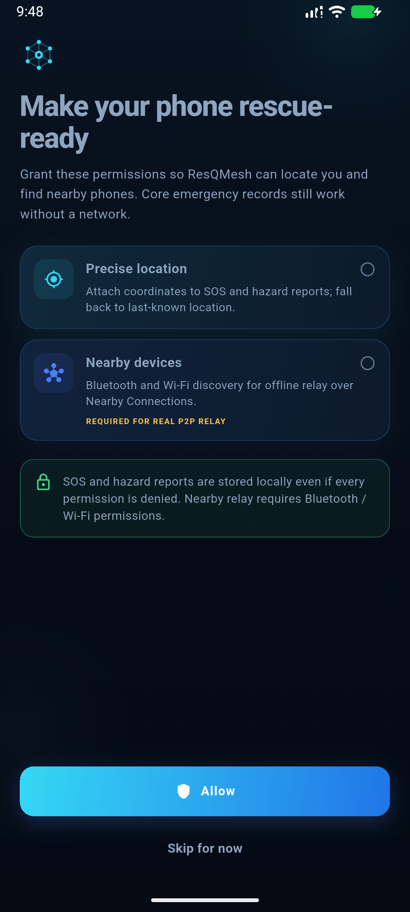
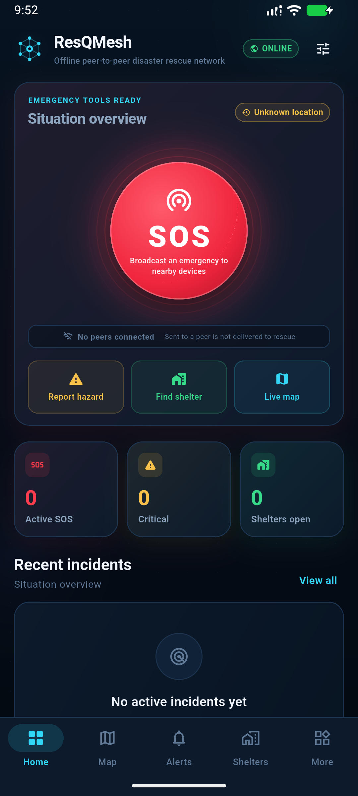
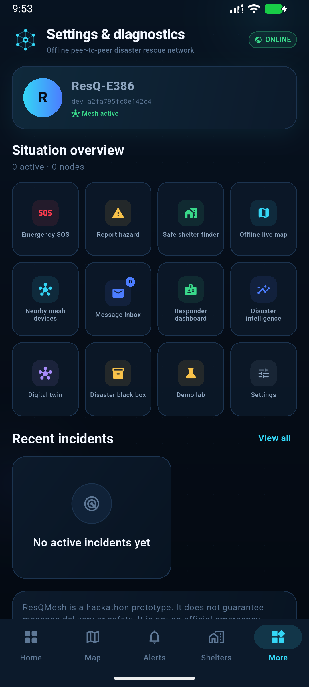
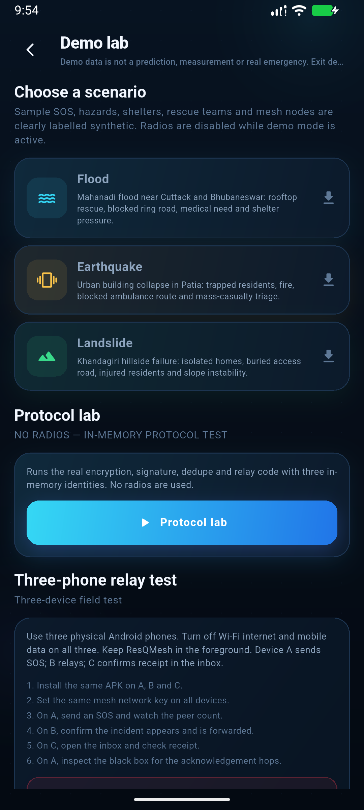
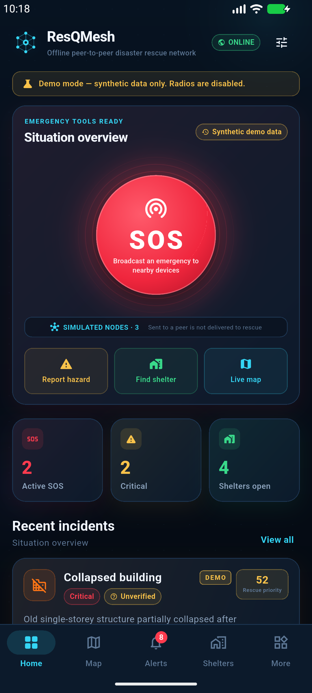

# ResQMesh

**An Intelligent Offline Peer-to-Peer Disaster Rescue and Hazard Intelligence Network**

ResQMesh turns Android phones and iPhones into a local emergency mesh. It sends SOS alerts and
hazard reports directly over Bluetooth/Wi-Fi — Google Nearby Connections on Android and Apple
MultipeerConnectivity on iOS — relays them through intermediate phones, and builds a
transparent local hazard picture with **no internet, cellular data, central server, or backend
dependency** for the emergency core.

> **Hackathon prototype, not an official emergency service.** ResQMesh does not guarantee
> message delivery, rescue response, shelter availability, or route safety. No P2P radio
> transmission was possible to validate on three physical phones in the development
> environment; the relay state machine is covered by automated three-node tests and the
> field-test procedure is documented in [`docs/FIELD_TEST_3_DEVICE.md`](docs/FIELD_TEST_3_DEVICE.md).
>
> **iOS status:** the iOS target and Swift MultipeerConnectivity transport are included in
> source, but **no IPA was built or hardware-tested** because this host is Windows and Xcode
> is required. iOS peers with iOS only; Android Nearby and iOS MultipeerConnectivity do not
> interoperate. See [`docs/IOS_BUILD.md`](docs/IOS_BUILD.md).

---

## What is real, what is simulated

| Capability | Status |
|---|---|
| Android Nearby Connections discovery / connection / byte transport (Kotlin) | **Implemented.** Compiles into the APK; requires Android + Google Play services + runtime permissions. Hardware radio test pending. |
| iOS MultipeerConnectivity discovery / connection / byte transport (Swift) | **Implemented in source.** Requires macOS/Xcode to compile; no IPA built or iOS hardware test performed on this Windows host. |
| Android ↔ iOS peer interoperability | **Not supported.** Nearby Connections and MultipeerConnectivity are different transports. Mesh with devices on the same platform family. |
| Multi-hop message relay, duplicate suppression, expiry, hop limits, priority queue, store-and-forward, acknowledgement | **Implemented in Dart and tested with 3 nodes.** |
| Ed25519 signatures + AES-256-GCM group payload encryption + TOFU key pinning | **Implemented and unit tested.** |
| SQLite persistence for incidents, messages, peers, shelters, votes, audit log, transmissions | **Implemented and tested with sqflite FFI.** |
| Offline maps with disk-cached CARTO dark tiles, OSM fallback, and generated offline tiles | **Implemented.** Online tiles are cached opportunistically; blocked providers fall through automatically; marker/route features work without tiles. |
| Rule-based hazard clustering, verification, priority scoring, A* evacuation routing | **Implemented and unit tested.** Transparent rules, no ML model. |
| Three-device A→B→C radio demonstration | **Not performed on physical hardware.** Automated fake-transport integration test proves the service-level relay path. |
| Demo flood / earthquake / landslide scenarios | **Synthetic and visibly labelled.** All demo rows carry `is_demo = 1`; the real transport refuses demo envelopes. |
| Protocol lab A→B→C simulation | **Real protocol code, in-memory identities, no radios.** Clearly labelled SIMULATION. |
| Online backend / PostgreSQL / Next.js dashboard | **Not implemented.** Online components were optional; offline core was prioritised. |
| Foreground service for screen-off relay | **Not implemented.** Keep the app in the foreground for field tests. |

---

## Feature summary

- **Self-healing mesh** — advertise, discover, connect, relay opaque frames; unique IDs,
  duplicate detection, TTL, hop cap, rate limiting, priority ordering, reconnect
  store-and-forward and best-effort acknowledgements.
- **Intelligent SOS** — large hold-free emergency button, GPS or manual location,
  category/severity/people count, unique ID, local persistence, accurate transmission
  state. Works with no peers (queued locally) and no internet.
- **Hazard intelligence** — flood, landslide, fire, collapse, blocked road, medical and
  infrastructure reports clustered by category, distance and time; every score explains
  its contributing factors and separates **observed reports** from **estimated risk**.
- **Crowd verification** — unverified, community corroborated, responder verified,
  disputed and expired. Only separately authored reports from distinct origin devices
  count; forwarding is never treated as independent confirmation.
- **Rescue priority** — severity, people affected, waiting time, report reliability,
  location confidence and (when available) responder proximity, with per-factor points.
  Human responders remain in control.
- **Offline evacuation** — cached CARTO/OSM map tiles, known shelters, hazard buffers and an A*
  grid route with explicit incompleteness/staleness warnings and no safety guarantee.
- **Last-known survivor location** — preserved timestamp, accuracy, source and manual
  landmark description; old locations are never rendered as live.
- **Disaster digital twin** — interactive 2D map, animated critical markers, risk circles,
  layer toggles and a time-window slider.
- **Disaster black box** — append-only local audit trail with JSON export.
- **Responder dashboard** — local PIN-gated triage, verification/dispute, status and
  shelter updates, all audited. The PIN is a local role gate, not an agency credential.
- **15+ screens**, English / Hindi / Odia, dark navy emergency design system. Core navigation,
  emergency forms, statuses and safety labels are localized; long synthetic scenario narratives
  and some technical diagnostics remain English.
- **Demo lab** — flood, earthquake and landslide scenarios plus a three-identity protocol
  test with tamper, expiry and duplicate rejection.

---

## Screenshots

| Onboarding | Permissions | Home |
|---|---|---|
|  |  |  |

| Feature hub | Demo lab | Demo mode |
|---|---|---|
|  |  |  |

Captures are from the Android emulator visual pass. The emulator's System UI became unstable
under software rendering; screenshots for map/SOS/intelligence/digital twin should be retaken
on a physical phone during rehearsal.

---

## Architecture at a glance

```
┌──────────────────────── Android / iOS app ──────────────────────────┐
│ Flutter UI (features/, widgets/)                                    │
│        │ Provider / ChangeNotifier                                  │
│        ▼                                                            │
│ AppState ── services/ (mesh, verification, intelligence, priority,  │
│             evacuation, demo, responder, audit)                     │
│        │                                                            │
│        ├── MeshService ── MeshCryptoService + TrustService          │
│        │        │              Ed25519 / AES-256-GCM / TOFU          │
│        │        ├── SQLite repositories (sqflite)                   │
│        │        └── NearbyTransport (MethodChannel + EventChannel)  │
│        ▼                                                            │
│ SQLite: incidents · messages · peers · shelters · verifications     │
│         events · transmissions · location_history · known_devices   │
└──────────────────────────────┬──────────────────────────────────────┘
                               │ opaque bytes
          ┌────────────────────┴────────────────────┐
          ▼                                         ▼
┌──────────────────────────────┐       ┌──────────────────────────────────┐
│ Kotlin NearbyMeshPlugin      │       │ Swift MultipeerMeshPlugin       │
│ Android Nearby Connections   │       │ iOS MultipeerConnectivity        │
│ advertise/discover/send      │       │ advertise/browse/invite/send     │
│ NO routing or trust logic    │       │ NO routing or trust logic        │
└──────────────────────────────┘       └──────────────────────────────────┘
```

Full details: [`docs/ARCHITECTURE.md`](docs/ARCHITECTURE.md) and
[`docs/PROTOCOL.md`](docs/PROTOCOL.md).

---

## Quick start (Windows + VS Code)

```powershell
cd C:\path\to\ResQMesh
flutter pub get
flutter analyze
flutter test
flutter run -d <android-device-id>
```

Build installable APKs:

```powershell
flutter build apk --release
# dist\resqmesh-release.apk (61 MB, signed with debug key for hackathon use)

flutter build apk --debug
# dist\resqmesh-debug.apk (larger, useful for logcat/field diagnostics)
```

Checksums are in [`dist/SHA256SUMS.txt`](dist/SHA256SUMS.txt). The release APK is signed with
the local debug key so it installs without extra setup; replace the keystore before public
distribution.

Detailed prerequisites, emulator notes, VS Code setup and troubleshooting:
[`docs/SETUP_WINDOWS_VSCODE.md`](docs/SETUP_WINDOWS_VSCODE.md).
APK/signing/build notes: [`docs/APK_BUILD.md`](docs/APK_BUILD.md).

### iOS build

iOS compilation requires **macOS with Xcode 15+**. On this Windows host the iOS source can be
edited and analyzed, but not compiled.

```bash
flutter pub get
cd ios && pod install   # only if the generated project uses CocoaPods
cd ..
flutter run -d <iphone-device-id>
flutter build ipa --release
```

Full signing, Local Network permission, simulator and three-iPhone test guide:
[`docs/IOS_BUILD.md`](docs/IOS_BUILD.md).

**Requirements:** Android 7.0+ (minSdk 24) with Google Play services for Nearby Connections,
or iOS 15+ with Bluetooth/Wi-Fi and Local Network permission. Android requires Bluetooth
permissions (12+) and Nearby Wi-Fi devices permission (13+).

---

## Three-device proof of concept

```text
Device A (SOS)  ──Nearby/MPC bytes──▶  Device B (relay)  ──Nearby/MPC bytes──▶  Device C (volunteer)
      ▲                                                                          │
      └──────────────────── acknowledgement: C → B → A ◀────────────────────────┘
```

> All three phones must be **all Android or all iPhone**. Android Nearby and iOS MultipeerConnectivity do not interoperate.

1. Install the same app build on A, B and C.
2. Set the **same mesh network key** on all three (Settings → Mesh network key).
3. Disable mobile data and Wi-Fi internet on all three; keep Bluetooth and Wi-Fi radios on.
4. Grant location + nearby permissions and start the mesh on all three.
5. A sends an SOS; B stores/relays; C sees the incident and sends a receipt.
6. A shows **receipt confirmed** and the black box records the relay and acknowledgement.

Exact click-by-click steps, distance setup, expected evidence and troubleshooting:
[`docs/FIELD_TEST_3_DEVICE.md`](docs/FIELD_TEST_3_DEVICE.md).

> Receipts are best-effort and are **not** proof of rescue. The app never labels a message
> as “delivered” without an authenticated acknowledgement.

---

## Demo mode

Open **More → Demo lab**. Choose Flood, Earthquake or Landslide. ResQMesh seeds a realistic
synthetic scenario (incidents, SOS, shelters, rescue teams, scenario nodes) and disables the
real radio transport while demo mode is active. Every demo record is labelled **DEMO** and
stored with `is_demo = 1`. Exiting demo deletes only synthetic rows.

The **Protocol lab** runs the real crypto/relay code with three in-memory identities and
demonstrates tamper rejection, expiry rejection, duplicate suppression and acknowledgement.
It is explicitly labelled **NO RADIOS — IN-MEMORY PROTOCOL TEST**, and its result is not
presented as a live three-phone transmission.

---

## Tests

```text
flutter analyze   → No issues found
flutter test      → 41 tests pass
iOS build         → requires macOS/Xcode; not run on this Windows host
```

Coverage includes:

- envelope seal/open, signature tamper, identity binding, wrong key, expiry, malformed input;
- three-node `MeshService` relay, C→B→A acknowledgement, duplicate replay rejection and
  forged-identity rejection over a fake byte transport;
- verification rules (same-origin forwarding does **not** count; distance/time/category;
  responder and dispute states; demo/real isolation);
- hazard clustering and explainable factor scores;
- priority ordering and missing responder-proximity handling;
- A* evacuation around hazards and uncertainty warnings;
- SQLite CRUD, demo isolation and black-box append-only behaviour;
- protocol-lab adversarial checks and trilingual string checks;
- widget smoke tests for SOS button and key components.

Results: [`docs/TEST_RESULTS.md`](docs/TEST_RESULTS.md).

---

## Security and honest limitations

- **Implemented:** Ed25519 origin signatures, AES-256-GCM payload encryption, device-ID
  binding, TOFU key pinning, replay/duplicate suppression, TTL and hop caps, malformed
  message rejection, per-origin rate limiting, app-private SQLite, backups disabled.
- **Not implemented / limits:** the default mesh passphrase is public and must be changed;
  group members can decrypt each other's traffic; TOFU is not a PKI; routing metadata is
  not origin-signed; SQLite is app-private but not SQLCipher-encrypted; responder PIN is a
  local role gate, not government/agency identity; there is no foreground service; there
  is no backend sync; no route or delivery guarantee.
- **No security feature is claimed solely from UI text.** See
  [`docs/SECURITY_AND_LIMITATIONS.md`](docs/SECURITY_AND_LIMITATIONS.md) for the threat
  model and test evidence.

---

## Project layout

```text
lib/
  core/
    database/          SQLite schema + repositories
    localization/      English / Hindi / Odia
    location/          GPS + last-known fallback
    networking/        transport contract, Nearby transport, payloads, rate limiter
    security/          Ed25519/AES-GCM, secure storage, TOFU trust
    theme/             navy emergency design system
    utilities/         offline tile cache + tile provider, formatters
  features/            onboarding, home, sos, map, shelters, mesh, responder,
                       intelligence, digital twin, history, settings, demo, shell
  models/              incidents, envelopes, shelters, zones, priorities, routes
  services/            AppState, mesh relay, verification, intelligence, priority,
                       evacuation, demo data, responder, audit, protocol simulation
  widgets/             SOS button, incident cards, offline map, common components
android/app/src/main/kotlin/com/resqmesh/resqmesh/
  MainActivity.kt
  NearbyMeshPlugin.kt  Android Nearby Connections transport (Kotlin)
ios/Runner/
  AppDelegate.swift    iOS MultipeerConnectivity transport + registration (Swift)
  Info.plist           Local Network, Bonjour, Bluetooth and location permissions
test/                  unit, integration, widget tests
docs/                  architecture, protocol, iOS, field test, presentation, setup, security
```

---

## Deliverables

| Deliverable | Location |
|---|---|
| Installable release APK | [`dist/resqmesh-release.apk`](dist/resqmesh-release.apk) |
| Debug APK (diagnostics) | [`dist/resqmesh-debug.apk`](dist/resqmesh-debug.apk) |
| Complete Flutter source | `lib/` |
| Native Android Nearby transport | `android/app/src/main/kotlin/com/resqmesh/resqmesh/NearbyMeshPlugin.kt` |
| Native iOS MultipeerConnectivity transport | `ios/Runner/AppDelegate.swift` |
| Tests | `test/` |
| Architecture / protocol docs | `docs/ARCHITECTURE.md`, `docs/PROTOCOL.md` |
| Three-phone field test | `docs/FIELD_TEST_3_DEVICE.md` |
| Hackathon presentation script | `docs/PRESENTATION_AND_DEMO_SCRIPT.md` |
| Windows/VS Code setup | `docs/SETUP_WINDOWS_VSCODE.md` |
| APK build instructions | `docs/APK_BUILD.md` |
| iOS source + build guide | `ios/`, `docs/IOS_BUILD.md` (no IPA built on Windows) |
| iOS-ready source bundle | `dist/ResQMesh-iOS-source.zip` |
| Security & limitations | `docs/SECURITY_AND_LIMITATIONS.md` |
| Test results | `docs/TEST_RESULTS.md` |

## Documentation

- [Architecture](docs/ARCHITECTURE.md)
- [Wire protocol](docs/PROTOCOL.md)
- [Windows + VS Code setup](docs/SETUP_WINDOWS_VSCODE.md)
- [APK build and install](docs/APK_BUILD.md)
- [iOS build, signing and three-iPhone test](docs/IOS_BUILD.md)
- [Three-device field test](docs/FIELD_TEST_3_DEVICE.md)
- [Hackathon presentation & demo script](docs/PRESENTATION_AND_DEMO_SCRIPT.md)
- [Security & limitations](docs/SECURITY_AND_LIMITATIONS.md)
- [Test results](docs/TEST_RESULTS.md)
- [Requirements traceability](docs/REQUIREMENTS_TRACEABILITY.md)

---

## License / use

Hackathon prototype. Do not deploy as an official emergency-response system without
security review, field validation, agency credentials, encrypted database storage,
foreground-service hardening and local emergency-service integration.
